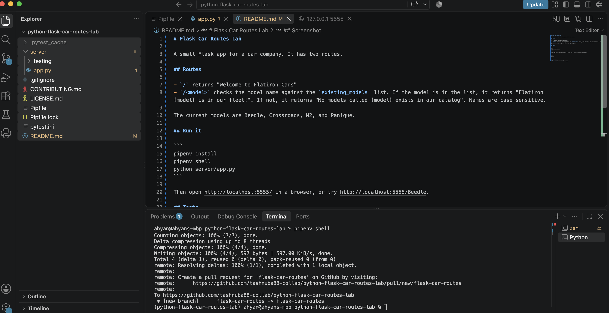

# Flask Car Routes Lab

A small Flask app for a car company. It has two routes.

## Routes

- `/` returns "Welcome to Flatiron Cars"
- `/<model>` checks the model name against the `existing_models` list. If the model is in the list, it returns "Flatiron {model} is in our fleet!". If not, it returns "No models called {model} exists in our catalog". Names are case sensitive.

The current models are Beedle, Crossroads, M2, and Panique.

## Run it

```
pipenv install
pipenv shell
python server/app.py
```

Then open http://localhost:5555/ in a browser, or try http://localhost:5555/Beedle.

## Tests

```
pytest
```

## Screenshot

